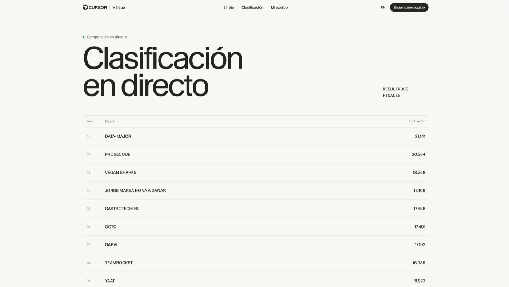
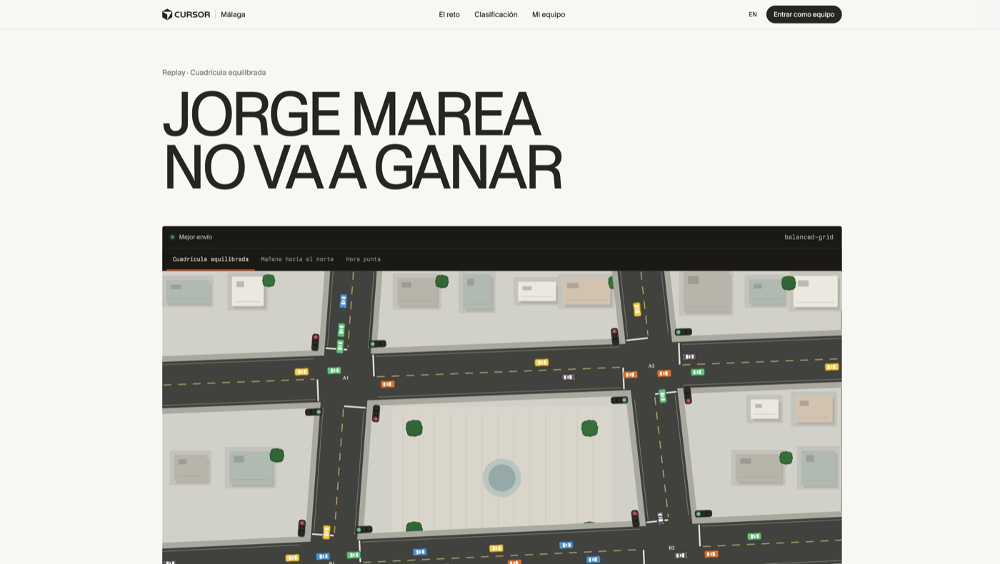

<p align="center">
  
</p>

<h1 align="center">Traffic Lights Arena</h1>

<p align="center">
  <strong>Cursor Build Night · Málaga · July 23, 2026</strong><br/>
  Adaptive traffic-signal control with <em>agentic AI</em> — multi-agent exploration + exploitation of the best controller
</p>

<p align="center">
  
  
  
  
</p>

<p align="center">
  <a href="https://www.cursorspain.com/mlg/es">Event</a> ·
  <a href="https://github.com/arrozet/cursor-semaphore/tree/strategy-b-optimization">Winning controller (`strategy-b-optimization`)</a> ·
  <a href="challenge.md">Challenge rules</a>
</p>

---

## Result

**4th of 17 teams** on the final leaderboard (20% public maps + 80% sealed suite).

Team: **JORGE MAREA NO VA A GANAR** · final score **18.108**

<p align="center">
  
</p>

<p align="center">
  
</p>

---

## The problem

In **105 minutes**, change a single file: `controller.py`.

The engine simulates a city at discrete ticks. You only choose, per intersection, whether green goes to `NS_GREEN` or `EW_GREEN`. Yellow, all-red, and minimum greens are handled by the simulator.

The hard part was not “move cars” — it was **generalization**. There were only **3 public maps**; the real score came from **unknown private maps**. A controller overfit to the public set would die in the finals.

Per-scenario cost (from the engine):

```text
cost = wait_ticks + 300 × unfinished
```

Every car that **does not finish** by the end of the episode costs **+300**. Scores across maps are aggregated with a **geometric mean**, so one bad scenario hurts far more than a great scenario helps.

---

## Approach: explore → exploit

Build Night was built for **agentic AI**: abstract problems, unfamiliar APIs, little time. Our strategy was not “one model that solves traffic,” but **orchestrating agents** with a clear loop.

### 1. Understand the game

- Read the engine, scoring, and constraints
- Benchmark heuristics (fixed-time, local max-pressure, global sync…)
- Discover that **desynchronizing junctions collapses** large grids → use **network-wide synchronized** phases

### 2. Exploration (several agents in parallel)

Once the solution space was clear, we launched agents in **separate worktrees/branches**, each with a thesis:

| Strategy | Idea |
|---|---|
| A · Completion-aware | Endgame drain |
| **B · Sync max-pressure** | Synchronized corridor + hysteresis / gap-out |
| C · Demand-ratio | Split from an EMA of demand |
| D · Travel / floor | Infer travel time and raise the floor |

We scored them on:

1. the **3 public maps**, and  
2. our own stress suite (`maps/alesuito`, ~41 scenarios) to force generalization before facing the private set.

### 3. Exploitation (optimize the leader)

When **B** won on public + alesuito geometric mean, branch
[`strategy-b-optimization`](https://github.com/arrozet/cursor-semaphore/tree/strategy-b-optimization)
switched to exploit mode:

- raise **minimums** (geom mean punishes the worst map)
- cut **unfinished** cars (`+300` each)
- late soft-hold / freeze and **spike-gated drain** (variant U9) without breaking the public floor

That controller is what we submitted — and what represents the team result.

```text
PUBLIC geom  ≈ 22,983   (same as base B)
ALL geom     ≈ 20,996   (public + alesuito; +527 vs B)
```

---

## Why the geometric mean matters

With an arithmetic mean you can “buy” a bad map with an excellent one.  
With a geometric mean, **the floor dominates**.

So exploitation did not chase peaks on a single scenario. It aimed to:

- lift `combo-4x4-sparse-slow`, `fast-travel-*`, saturated grids, endgame floods…
- avoid useless late switches
- not leave platoons stranded (each unfinished hurts ×300)

---

## Repo layout

```text
source/controller.py          # challenge entry point
source/traffic_arena/         # engine + scoring
maps/alesuito/                # custom stress suite (generalization)
variants/                     # ablations (E, U, …)
strategy-b-optimization       # submitted controller branch (U9 on top of B)
docs/assets/                  # README screenshots & hero art
```

> The team’s production controller lives on
> [`strategy-b-optimization`](https://github.com/arrozet/cursor-semaphore/tree/strategy-b-optimization)
> (`source/controller.py` there = U9 spike-drain on Strategy B).

---

## Quick start

```bash
cd source
python3.12 -m venv .venv
source .venv/bin/activate
pip install -r requirements.txt
python run.py --scenario balanced-grid
```

To evaluate a local battery (public maps + sidecars under `maps/`):

```bash
python eval_all.py controller.py
```

---

## Stack & constraints

- Python (stdlib + NumPy)
- One editable file in competition: the controller
- Memory **within** a map; clean process between maps
- Scoring: squared baseline→gold curve; geometric aggregation; finals by families (min of each pair)

---

## Credits

- Event: [Cursor Build Night Málaga](https://www.cursorspain.com/mlg/es) — *Traffic Lights Arena*
- Starter / engine: Cursor Málaga (MIT, see `source/LICENSE`)
- Viewer assets: Kenney (see `source/viewer/assets/KENNEY-LICENSE.txt`)

---

<p align="center">
  <sub>An agentic-AI hackathon: agents explore competing hypotheses, humans decide what to exploit, and the metric punishes failing to generalize.</sub>
</p>
